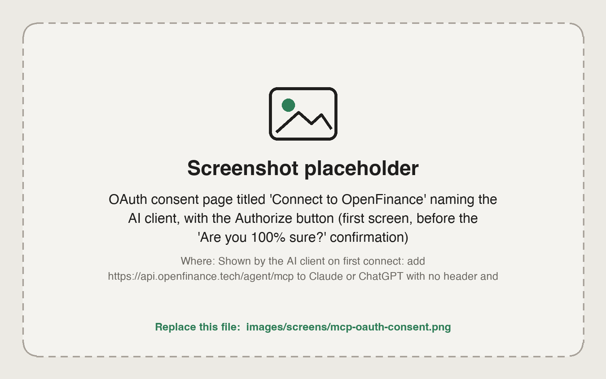
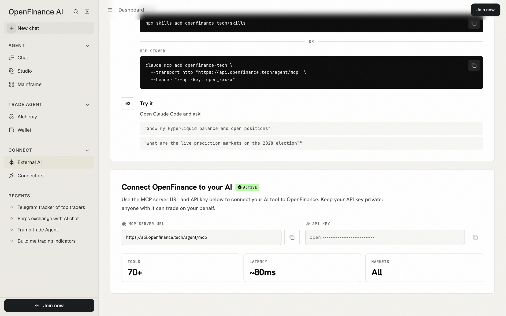

There are two ways to do it, OAuth sign-in or an API key, and both act on your own OpenFinance account. There is no keyless tier, even for market data.

Please make an account at [openfinance.tech](https://openfinance.tech) to get your keys.

## Two ways to authenticate

The right choice depends mostly on your client.

| | OAuth sign-in | API key |
| --- | --- | --- |
| How | Add the server URL only. Your client opens an OpenFinance sign-in and consent page | Send your key in an `x-api-key` header |
| Good for | Chat clients and editors that support OAuth for remote MCP servers, such as Claude, ChatGPT, Cursor, VS Code and Claude Code | Scripts, bots, servers, and clients without OAuth support |
| What your client stores | A token it manages for you | Your API key |

Use OAuth when your client supports it, because no long-lived secret has to be pasted anywhere. Use the API key when you are writing code or when a client only accepts headers.

## OAuth sign-in

<Steps>
  <Step title="Add the URL">
    Add `https://api.openfinance.tech/agent/mcp` to your client with no header.
  </Step>
  <Step title="Sign in">
    The first time the client uses the server, it opens an OpenFinance page. Sign in. If you are new, signing in creates your account.
  </Step>
  <Step title="Approve the connection">
    A consent page names the client that is asking. Approve it, then confirm a second time. The second screen reminds you that the client will be able to place orders and move funds from your wallet.
  </Step>
</Steps>

<Frame caption="The consent page names the client you are connecting and asks you to confirm">
  
</Frame>

<Warning>
Only approve a connection you started yourself. If a consent page appears that you did not expect, close it.
</Warning>

For client builders: the server follows the MCP authorization flow. A client discovers the authorization server from the `WWW-Authenticate` header on the first `401`, registers itself dynamically, and uses PKCE.

## API key

Your account has one API key. It starts with `open_`.

<Steps>
  <Step title="Open External AI">
    Sign in at [openfinance.tech](https://openfinance.tech) and open **External AI** in the sidebar.
  </Step>
  <Step title="Copy the key">
    Under **Connect OpenFinance to your AI** you see the MCP server URL and your API key, each with a copy button.
  </Step>
  <Step title="Send it as a header">
    Add `x-api-key: open_...` to every request, or to your client's MCP config.
  </Step>
</Steps>

<Frame caption="The External AI page shows the MCP server URL and your API key">
  
</Frame>

Keep the key in an environment variable rather than in a file:

```bash
export OPENFINANCE_API_KEY="open_..."
```

```bash
curl -s https://api.openfinance.tech/agent/mcp \
  -H "x-api-key: $OPENFINANCE_API_KEY" \
  -H "Content-Type: application/json" \
  -H "Accept: application/json, text/event-stream" \
  -d '{"jsonrpc":"2.0","id":1,"method":"tools/list"}'
```

The same key also works for the [Inference API](/inference/overview).

<Warning>
Treat your API key like a password. It carries the same permissions as your account, including placing trades and sending funds from your wallet. Never commit it, and never paste it into a shared chat, an issue or a screenshot.
</Warning>

## What happens without credentials

When a call is not authenticated, the response tells you what went wrong and how to fix it.

| Response | Meaning | Fix |
| --- | --- | --- |
| `401` with no key and no sign-in | Expected. The server points OAuth clients to the sign-in page | Sign in, or add the `x-api-key` header |
| `401` with a key | The key is wrong or malformed | Copy it again from External AI and check that it starts with `open_` |
| `412` | You are signed in, but account setup is incomplete for this action | Open [openfinance.tech](https://openfinance.tech), finish setup, and follow the instructions in the error |

A `401` applies to every tool, read-only ones included. If a guide elsewhere says market data works without a key, it is out of date.

## Tips

- One key covers every tool and the inference API. You do not need a key per venue.
- Check that the key and wallet work with one call to `get_wallet_addresses`. See [Verifying the connection](/reference/verifying-connection).
- Do not put the key into the model's context. Send it in headers only.
- Prefer environment variable expansion in config files, for example `${OPENFINANCE_API_KEY}`, where your client supports it.

## FAQ

<AccordionGroup>
  <Accordion title="Can I use both OAuth and a key?">
    Use one per client. A client that sends the `x-api-key` header does not need the sign-in page.
  </Accordion>
  <Accordion title="Does an API key limit what an agent can do?">
    No. A key acts as your account. Control comes from confirmations: the agent is instructed to ask before every write, and your client can ask for tool approval. See [Safety and custody](/reference/safety-and-custody).
  </Accordion>
  <Accordion title="The sign-in page says there is no API key on my account">
    Open [openfinance.tech](https://openfinance.tech) once while signed in so the key is created, then retry.
  </Accordion>
</AccordionGroup>

## Next

<CardGroup cols={2}>
  <Card title="MCP overview" icon="plug" href="/mcp/overview">
    Endpoint, flow and tool families.
  </Card>
  <Card title="API keys" icon="key" href="/getting-started/api-keys">
    Getting started with your key.
  </Card>
</CardGroup>
