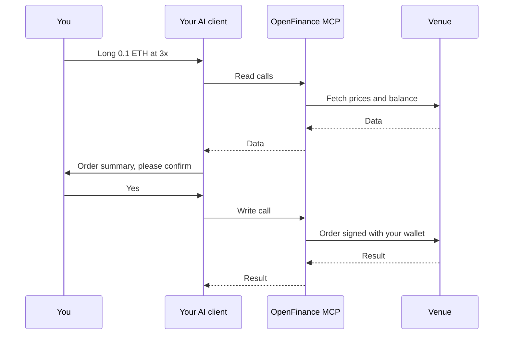

The OpenFinance MCP server gives an AI agent the same trading abilities you have in the OpenFinance app. It is hosted, so there is nothing to install or run. You add one URL to your AI client and sign in.

## What it is

MCP (Model Context Protocol) is a standard way for AI clients such as Claude, ChatGPT or Cursor to call external tools. The OpenFinance server exposes trading tools over that standard, at one address:

<CardGroup cols={2}>
  <Card title="Endpoint" icon="link">
    `https://api.openfinance.tech/agent/mcp`
  </Card>
  <Card title="Transport" icon="signal-stream">
    Streamable HTTP
  </Card>
</CardGroup>

Every request needs OAuth sign-in or an `x-api-key: open_...` header. There is no keyless tier, even for market data. Please make an account at [openfinance.tech](https://openfinance.tech) to get your keys. See [Authentication](/mcp/authentication).

## How a request flows

Here is what happens when you ask your client for a trade, from the first read to the signed order.



1. Your client connects and authenticates as your OpenFinance account.
2. The model reads the tool list. Each tool description tells the model which action to pick, what to check first and when to ask you.
3. Read calls fetch prices, balances and positions.
4. Before a write call, the agent shows you a summary and waits for your yes. Your client may also ask you to approve the tool call.
5. OpenFinance signs the action with your embedded wallet and sends it to the venue.

Every trade needs your confirmation. Nothing here is financial advice.

## Tool families

The tools fall into six families, one per venue or job. Each row links to its full reference.

| Family | Tools | Covers |
| --- | --- | --- |
| Hyperliquid | `hyperliquid` | Perps, spot, HIP-3 markets, HIP-4 outcomes, TWAP, leverage, withdrawals. [Reference](/mcp/tools-hyperliquid) |
| Polymarket | `polymarket` | Events, odds, order books, trader data, orders, redeeming, cashing out. [Reference](/mcp/tools-polymarket) |
| Onchain | `onchain_search_tokens`, `onchain_get_token_metadata`, `onchain_get_token_usd_price`, `onchain_get_address_holdings`, `onchain_send_token`, `onchain_jupiter_order`, `onchain_jupiter_execute` | Token data, holdings, same-chain sends, Solana swaps. [Reference](/mcp/tools-onchain) |
| Relay | `relay_get_quote`, `relay_execute`, `relay_get_status` | Bridges, cross-chain swaps, EVM swaps. [Reference](/mcp/tools-relay) |
| Launchpads | `openfinance-launchpad`, `openfinance-launchpad-wrapper`, `openfinance-launchpad-v4`, `openfinance-pons-launch` | Token launches on Solana and Robinhood Chain. [Reference](/mcp/tools-launchpads) |
| Wallet and onramp | `get_wallet_addresses`, `get_onramp_url` | Your addresses and a card or bank checkout link. [Reference](/mcp/tools-wallet-and-onramp) |

At the time of writing the server lists 18 tools. The list can grow, so call `tools/list` for the live set; see [Verifying the connection](/reference/verifying-connection).

### One tool, many actions

The larger tools group many operations behind a single tool with an `action` parameter. For example:

```json
{
  "name": "hyperliquid",
  "arguments": { "action": "get_all_mids" }
}
```

Pass only the parameters listed for that action.

## Use it from your own code

Any MCP client library that supports Streamable HTTP works. With the official TypeScript SDK:

```ts
import { Client } from "@modelcontextprotocol/sdk/client/index.js";
import { StreamableHTTPClientTransport } from "@modelcontextprotocol/sdk/client/streamableHttp.js";

const transport = new StreamableHTTPClientTransport(
  new URL("https://api.openfinance.tech/agent/mcp"),
  { requestInit: { headers: { "x-api-key": process.env.OPENFINANCE_API_KEY! } } },
);

const client = new Client({ name: "my-trading-agent", version: "1.0.0" });
await client.connect(transport);

const { tools } = await client.listTools();
console.log(tools.map((t) => t.name));

// Read only: mid prices for every Hyperliquid market
const mids = await client.callTool({
  name: "hyperliquid",
  arguments: { action: "get_all_mids" },
});
console.log(mids.content);
```

<Tip>
Pass the tool descriptions to your model unchanged. They carry the checks that keep an agent from sending a malformed or unconfirmed order.
</Tip>

## Tips

- **Install the skills too.** The MCP server is the live tool layer; the skills are playbooks that teach an agent to use it well. See [Installing skills](/getting-started/installing-skills).
- **Keep tool approval on.** Do not add OpenFinance write tools to an auto-approve list in your client.
- **Amounts are often in smallest units.** Onchain, Relay and launchpad tools take raw integer amounts. Read the token's decimals first.
- **Options are not on the MCP server.** They trade through a broker connected in the app. See [Options](/markets/options).

## Common errors

If a call fails, the status code usually tells you why.

| Status | Meaning |
| --- | --- |
| `401` | No valid sign-in or key. See [Authentication](/mcp/authentication) |
| `412` | Account setup is incomplete for this action, for example a Solana wallet that is not yet enabled for agent trading |
| `429` | Too many requests. Slow the agent down and retry |

More fixes are in [Troubleshooting](/reference/troubleshooting).

## Next

<CardGroup cols={2}>
  <Card title="Authentication" icon="key" href="/mcp/authentication">
    OAuth sign-in or an API key.
  </Card>
  <Card title="Quick install" icon="rocket" href="/getting-started/quick-install">
    Connect Claude Code in two commands.
  </Card>
  <Card title="Markets overview" icon="globe" href="/markets/overview">
    What each venue needs before you trade.
  </Card>
  <Card title="Safety and custody" icon="shield-halved" href="/reference/safety-and-custody">
    Confirmations, keys and what an agent can do.
  </Card>
</CardGroup>
