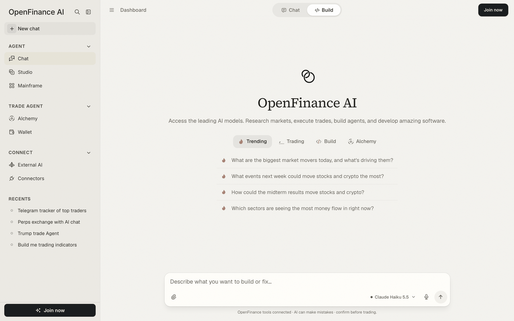
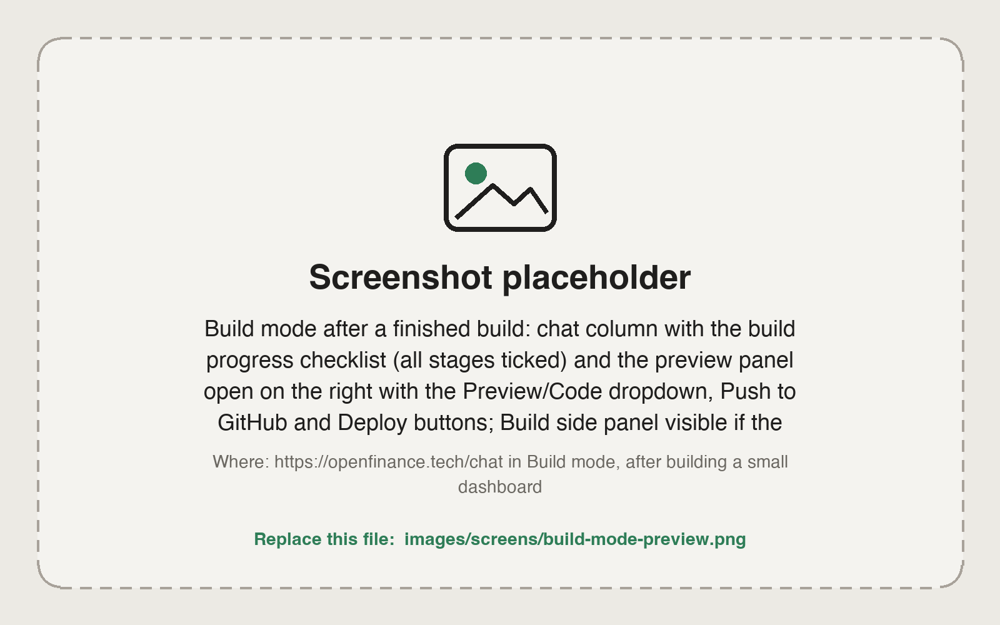
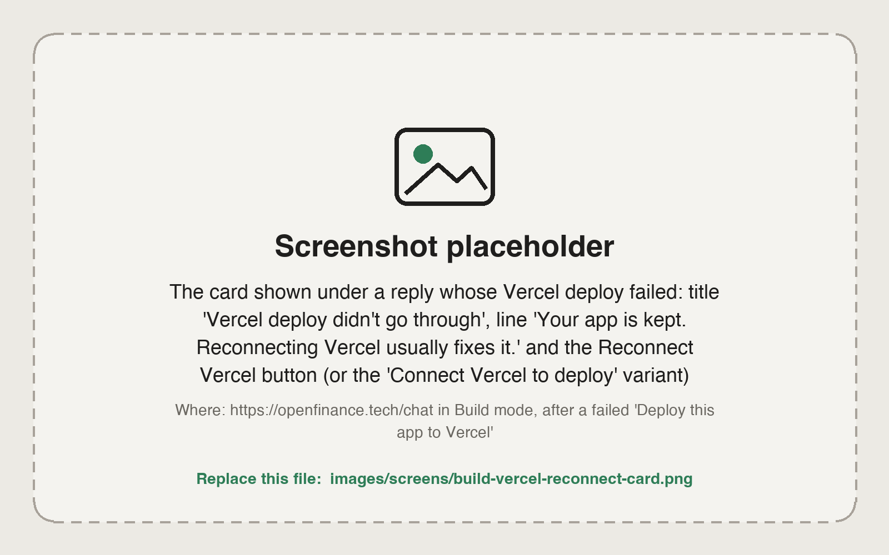

Build mode is the second mode of [Chat](/product/chat). Instead of answering in text, the agent answers with a working app you can click around in, then keeps changing it as you ask for more.

<Frame caption="Build selected in the top bar of the chat">
  
</Frame>

## How it works

In Build mode the model works with a private sandbox instead of only writing text. It creates files, installs packages, builds the app and gives you a preview you can click around in. The code is yours: push it to a GitHub repo, deploy it to Vercel for a permanent address, or copy it out of the Code view.

People use it for things like a Telegram bot that tracks posts, a live crypto dashboard with charts and alerts, a trading journal with a profit and loss calendar, a landing page for a token.

## Start a build

<Steps>
  <Step title="Switch to Build">
    Click **Build** in the toggle at the top of Chat. You can also type a build request in Chat mode and click **Switch to Build** on the hint, or pick a prompt from the **Build** starter tab.
  </Step>
  <Step title="Describe the app">
    Say what it does, what data it shows, and how it should look. The message box reads "Describe what you want to build or fix…".
  </Step>
  <Step title="Watch the checklist">
    A progress card tracks the build stage by stage: **Start the sandbox**, **Write the files**, **Install packages**, **Build the preview**, and **Write a summary**. A build error shows on its row while the agent fixes it.
  </Step>
  <Step title="Open the preview">
    When the build is done, the preview opens beside the chat by itself. It does not open midway, so you never look at a half-built app.
  </Step>
  <Step title="Ask for changes">
    Keep chatting: "make the chart taller", "add a dark theme", "fix the error on the settings page". The agent updates the files and rebuilds.
  </Step>
</Steps>

<Frame caption="Build mode: the chat with its progress checklist on the left, the live preview on the right">
  
</Frame>

## The preview panel

The panel header has everything you need to inspect and ship the app:

- **Preview / Code.** A dropdown switches between the running app and the files the agent wrote.
- **Push to GitHub.** Pick one of your repos and a branch, or create a new repository.
- **Deploy.** Pick a Vercel project, or create a new one.
- **Open in browser**, **Reload preview** and a copy button for the preview address or the current file.

Previews shut down after a while of not being used. Your code is saved, so the panel shows **Restore preview**; restoring starts a fresh sandbox and reinstalls packages, which takes up to a minute. If the files could not be saved, the chat offers **Rebuild the app** instead.

## The Build panel

On wide screens a side panel sits to the right of the chat. It folds to a thin strip when you do not need it.

| Box | What it shows |
| --- | --- |
| **Outputs** | Everything this chat produced: the app preview, the source code, and links to the deployed site and the GitHub repo |
| **Changes** | Files changed and lines added and removed, with **Push** and **Deploy** (or **Redeploy**) buttons |
| **Ship your app** | GitHub and Vercel, each with a **Connect** button until connected |
| **Credits** | Your AI credit balance and **Buy credits** |
| **Connectors** | The data and broker connectors on your account, with a link to manage them |
| **How Build works** | Describe the app, connect GitHub and Vercel, host it locally or on Vercel, hit Deploy |

## Ship it

Connect GitHub and Vercel once, from the Build panel or the [Connectors](/product/connectors) page. After that you can ship in two ways: click **Push** or **Deploy**, or simply ask.

```text
Push this app to a new GitHub repo.
```

```text
Deploy this app to Vercel.
```

A deploy gives the app a permanent address on your own Vercel account. The preview alone is temporary.

### When a deploy fails

If a Vercel deploy does not go through, the chat shows a card in place of a dead end:

<Frame caption="The card shown under a reply whose Vercel deploy failed">
  
</Frame>

1. If Vercel was never connected, the card reads **Connect Vercel to deploy**. Click **Connect Vercel** and sign in.
2. If it was connected and the deploy still failed, the card reads "Vercel deploy didn't go through". Your app is kept. Click **Reconnect Vercel**; reconnecting fixes most failed deploys.
3. Once connected, the card changes to **Vercel connected**. Click **Deploy again**. The agent redeploys the same app without rebuilding it.

## Example prompts

```text
Build a live crypto dashboard with price charts and alerts.
```

```text
Build a trading journal with a profit and loss calendar.
```

```text
Build a Telegram bot tracking Trump's posts on crypto and geopolitics.
```

```text
Build a landing page for my token with a live price chart.
```

```text
Build a one-page dashboard that shows Hyperliquid funding rates for the top 20 perps, sorted from highest to lowest, refreshing every minute.
```

## Tips

- One clear page beats a vague platform. Start small, look at the preview, then add features one message at a time.
- Name your data source ("Hyperliquid funding rates", "Polymarket odds") so the agent does not invent one.
- If a run pauses, click **Continue run**. It resumes from the last step.
- Building costs more credits than chatting because the agent writes many files. Pick a coding model that fits the size of the job; see [Models and AI credits](/product/models-and-credits).
- Apps written by AI can have bugs. Review what a bot does and test with small amounts before you trust it with funds.

## FAQ

<AccordionGroup>
  <Accordion title="Do I need GitHub and Vercel to build?">
    No. You can build and preview without them. You need them only to push the code or get a permanent address.
  </Accordion>
  <Accordion title="Can I see and copy the code?">
    Yes. Switch the preview panel to **Code** to browse the files, and use the copy button for the open file.
  </Accordion>
  <Accordion title="I started a build in Chat mode. Where is my app?">
    The reply shows an **Open in Build** card. Click it to see the code, the preview and the Build panel.
  </Accordion>
  <Accordion title="Is there a faster way to start?">
    Yes. [Mainframe](/mainframe/overview) has ready-made templates that open in Build mode with one click.
  </Accordion>
</AccordionGroup>

## Next

<CardGroup cols={2}>
  <Card title="Mainframe" icon="layer-group" href="/mainframe/overview">
    Start from a template instead of a blank prompt.
  </Card>
  <Card title="Connectors" icon="plug" href="/product/connectors">
    Connect GitHub and Vercel before you ship.
  </Card>
  <Card title="Chat" icon="comments" href="/product/chat">
    The other mode: research and trading.
  </Card>
  <Card title="Inference" icon="microchip" href="/inference/overview">
    Give the apps you build access to AI models.
  </Card>
</CardGroup>
