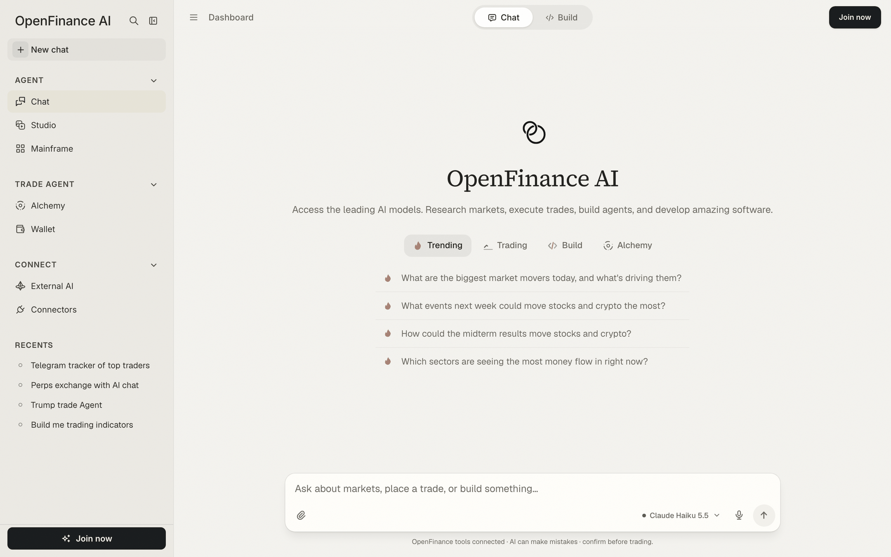

Most work in OpenFinance happens in Chat. You ask in plain language; the agent reads live market data, prepares trades from your wallet and, in Build mode, writes and runs apps, all from the same message box.

## How it works

Chat is connected to OpenFinance's market and wallet tools through your account. When you ask a question, the model decides which tools to call, shows each step as it runs, then writes the answer. Read-only steps (prices, balances, order books) run on their own. Steps that can place an order or move funds stop and show a **Confirm this action** card.

Each reply is paid for with [AI credits](/product/models-and-credits), and the model you pick sets the price.

<Note>
Every trade needs your confirmation, and nothing the chat says is financial advice. AI can be wrong, so read the confirmation card before you approve.
</Note>

## Chat mode and Build mode

A toggle at the top of the page switches between two modes.

| Mode | Use it to | Model list |
| --- | --- | --- |
| **Chat** | Research markets, check your account, place trades | Reasoning models, plus Free |
| **Build** | Turn a prompt into a working app with a live preview | Coding models, plus Free |

Every new chat starts in Chat mode. If you type something that reads like a build request, a hint appears above the message box: **Looks like something to build**, with a **Switch to Build** button. If you send it anyway, the app asks **Send this to Build?** and nothing starts until you pick **Go to Build** or **Send in Chat**. See [Build mode](/product/build-mode) for the full flow.

<Frame caption="The chat home: mode toggle on top, starter tabs under the message box">
  
</Frame>

## Starter tabs

A new chat shows four tabs of ready-made prompts. Click one to send it.

- **Trending**: what is moving markets today and what is coming up.
- **Trading**: questions about specific stocks, crypto and perp funding.
- **Build**: app ideas. Picking one switches to Build mode before it sends.
- **Alchemy**: event questions. Picking one opens [Alchemy](/alchemy/overview) instead of the chat.

## The message box

Besides typing, the message box takes files, long pastes and your voice.

- **Attach files.** Click the paperclip or drag files onto the box. You can add up to 5 attachments per message, 8 MB each. What a model can read depends on the model: some accept documents and images, some images only, and some text only. The button tells you when the chosen model cannot read a file type.
- **Paste long text.** A long paste (roughly six lines or more) becomes a card above the box instead of a wall of text. Up to 5 pasted texts per message.
- **Dictate.** In browsers that support speech recognition, a microphone button turns speech into text.
- **Pick a model.** The model picker sits in the message box. See [Models and AI credits](/product/models-and-credits).
- **Stop.** While a reply is being written, the send button becomes a stop button.

## Confirming a trade

When the agent wants to do something that can move funds or place an order, the reply pauses on a card.

<Steps>
  <Step title="Read the card">
    It names the action the agent wants to run and lists the exact inputs: market, side, size, price and so on.
  </Step>
  <Step title="Decide">
    Click **Approve & run** to send it, or **Deny** to cancel. The card then shows **Approved** or **Denied**.
  </Step>
  <Step title="Check the result">
    The agent continues with the outcome and reports what happened. Ask it to show the open order or position if you want proof.
  </Step>
</Steps>

## Watching the agent work

Tool steps appear as one line, such as "Fetching Polymarket markets" or "Searching the web", and collapse to "Ran 4 steps" when done. Click the line to expand it and see every step, including any marked **Failed** or **Paused**.

If a reply is cut off, the chat does not go quiet:

- **Continue run** picks up a paused run from its last step, without repeating a trade that already went through.
- **Try again** appears when no reply came back.
- **Retry** sits on every error message.

A reply keeps being written on the server even if you close the tab. Reopen the chat and you see "Still writing this reply" until it lands. While a reply is streaming, sidebar links offer to open in a new tab so the reply keeps going.

## Example prompts

```text
What are the biggest market movers today, and what's driving them?
```

```text
Where are perp funding rates most extreme right now?
```

```text
Compare $AAPL and $GOOGL on growth, margins and valuation.
```

```text
Show my Hyperliquid balance and open positions.
```

```text
What are the live prediction markets on the 2028 election? Show the odds and volume for the top five.
```

```text
Open a $50 long on ETH perps on Hyperliquid with 3x leverage. Show me the order before you place it.
```

## Tips

- Say the venue, the market, the side and the size. "Buy \$25 of Yes on the top Fed decision market on Polymarket" leaves less to guess than "bet on the Fed".
- Ask for a read first ("show the order book", "what would this cost") and the trade second.
- Use Chat mode for questions and trades, Build mode for apps. A cheaper model is fine for lookups; pick a stronger one for long research.
- Your past sessions are under **Recents** in the sidebar. Search them, filter by Chat, Studio or Alchemy, or delete one from its options menu.

## FAQ

<AccordionGroup>
  <Accordion title="Can the agent trade without asking me?">
    No. Actions that can move funds or place an order show the confirmation card, and nothing is sent until you approve.
  </Accordion>
  <Accordion title="Why did I get a 'Deposit to start chatting' message?">
    Your account has no AI credits yet. Add credits to continue. Free models also need a funded account before they can be used; see [Models and AI credits](/product/models-and-credits).
  </Accordion>
  <Accordion title="Does a new chat remember my last model?">
    No. Every new chat starts in Chat mode on the default model. A model you pick stays for that chat, and a reopened chat keeps the model it ran on.
  </Accordion>
  <Accordion title="Can I use Chat without signing in?">
    You can look around, but sending a message asks you to sign in first.
  </Accordion>
</AccordionGroup>

## Next

<CardGroup cols={2}>
  <Card title="Build mode" icon="hammer" href="/product/build-mode">
    Turn a prompt into an app with a live preview.
  </Card>
  <Card title="Models and AI credits" icon="coins" href="/product/models-and-credits">
    Choose a model and manage what it costs.
  </Card>
  <Card title="Markets" icon="chart-line" href="/markets/overview">
    What you can ask the chat to trade.
  </Card>
  <Card title="Alchemy" icon="flask" href="/alchemy/overview">
    Start from an event instead of a ticker.
  </Card>
</CardGroup>
