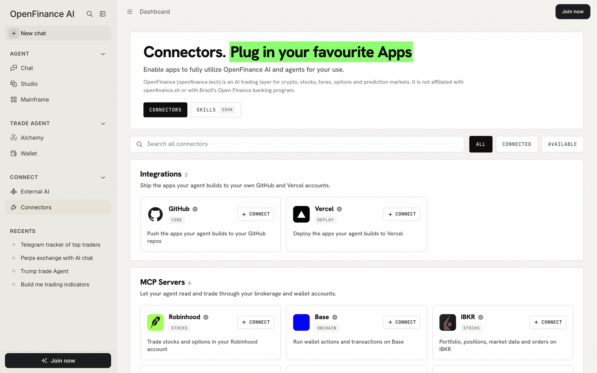

Each connector gives the agent one more place to work. Connect a brokerage and the chat can read and trade in that account; connect GitHub and Vercel and Build mode can ship your apps.

## How it works

There are two kinds of connector, shown as two sections on the page.

| Section | What it is for | How you connect |
| --- | --- | --- |
| **Integrations** | Shipping the apps your agent builds to your own GitHub and Vercel accounts | Sign in to the provider in a new tab |
| **MCP Servers** | Letting your agent read and trade through your brokerage and wallet accounts, or pull in outside data | Sign in to the provider, or paste an API token, depending on the connector |

Once a connector is connected, its tools are available in every chat. Nothing else changes: you still ask in plain language, and trades still wait for your confirmation.

<Note>
Every trade needs your confirmation, and nothing here is financial advice. Orders placed through a connected brokerage run in your own account at that broker, under that broker's rules.
</Note>

<Frame caption="The Connectors page: search and filters, then Integrations and MCP Servers">
  
</Frame>

## What you can connect

The list is served by OpenFinance and changes over time. At the time of writing the page shows:

| Connector | Type | What it does |
| --- | --- | --- |
| **GitHub** | Integration | Push the apps your agent builds to a repo in your own GitHub account |
| **Vercel** | Integration | Deploy the apps your agent builds to your own Vercel account, for a permanent address |
| **Robinhood** | Brokerage | Trade stocks and options through your connected Robinhood account |
| **IBKR** | Brokerage | Read your Interactive Brokers portfolio, positions and market data, and place orders |
| **Base** | Onchain | Run wallet actions and transactions on Base through your connected account |
| **Centaur** | Signals | Trading intelligence delivered to your agent |
| **Bitquery** | Onchain data | Onchain market data, wallets and traders across many chains |
| **Coinbase** | Crypto | Listed as **Coming soon** |

A connector marked **Coming soon** cannot be connected yet. The **Skills** tab at the top of the page is also marked Soon.

If you want to trade options, this is the way in: options trade through your own IBKR or Robinhood account connected here.

## Connect an account

<Steps>
  <Step title="Open Connectors">
    Click **Connectors** in the sidebar under Connect. Use the search box or the **All**, **Connected** and **Available** filters to find what you need.
  </Step>
  <Step title="Open the card">
    Click a card to read what the connector does and what connecting allows.
  </Step>
  <Step title="Click Connect">
    A new tab opens at the provider. Sign in and approve access. Some connectors ask you to paste an API token instead.
  </Step>
  <Step title="Come back">
    The tab closes by itself and the card shows **Connected**. For a connected MCP server, the card's details list the tools it gives the agent.
  </Step>
</Steps>

If your browser blocks the new tab, allow popups for the site; OpenFinance falls back to opening the sign-in in the current tab.

## Disconnect or reconnect

Open the connector's card and click **Disconnect**. This removes the connection on the OpenFinance side. To fully revoke access, also remove OpenFinance in the provider's own settings.

If a card shows "Last use failed", the last call to that connector returned an error. If it keeps happening, disconnect and connect again.

## Other places you will see connectors

The same connections show up in a few other places, so you can connect from wherever you are.

- **Settings > Integrations** and **Settings > MCP Servers** show the same connections with the same Connect and Disconnect buttons.
- **Build mode's side panel** has Connect buttons for GitHub and Vercel under **Ship your app**.
- **Mainframe** has the same two buttons at the top of the gallery.
- **Alchemy** lists brokers under **Markets connected**; **Enable** brings you to this page.

## Example prompts

After connecting a brokerage, ask in Chat:

```text
Show my Robinhood portfolio and today's change for each position.
```

```text
Show my IBKR portfolio and open positions.
```

```text
Show the NVDA option chain for the nearest monthly expiry in my Robinhood account.
```

After connecting GitHub and Vercel, ask in Build mode:

```text
Push this app to a new GitHub repo.
```

```text
Deploy this app to Vercel.
```

## Tips

- Connect GitHub and Vercel before you start a long build, so the deploy at the end does not stall.
- Connect only the accounts you want the agent to reach. A connected brokerage can place orders after you approve them.
- If a deploy fails in Chat, the reply shows a card to connect or reconnect Vercel and deploy again. See [Build mode](/product/build-mode).

## FAQ

<AccordionGroup>
  <Accordion title="Do I need to be signed in?">
    You can browse the page signed out. Connecting asks you to sign in.
  </Accordion>
  <Accordion title="Does OpenFinance see my brokerage password?">
    No. For sign-in connectors you sign in on the provider's own page and approve access there. A few connectors use an API token that you paste in instead.
  </Accordion>
  <Accordion title="Is this the same as connecting Claude or ChatGPT?">
    No. Connectors bring outside accounts into OpenFinance. To use OpenFinance from an outside AI tool, see [External AI](/product/external-ai).
  </Accordion>
</AccordionGroup>

## Next

<CardGroup cols={2}>
  <Card title="Build mode" icon="hammer" href="/product/build-mode">
    Use GitHub and Vercel to ship what you build.
  </Card>
  <Card title="External AI" icon="robot" href="/product/external-ai">
    The other direction: outside AI tools using OpenFinance.
  </Card>
  <Card title="Markets" icon="chart-line" href="/markets/overview">
    Which venues need a connector and which do not.
  </Card>
  <Card title="Alchemy" icon="flask" href="/alchemy/overview">
    See broker venues appear in trade ideas.
  </Card>
</CardGroup>
