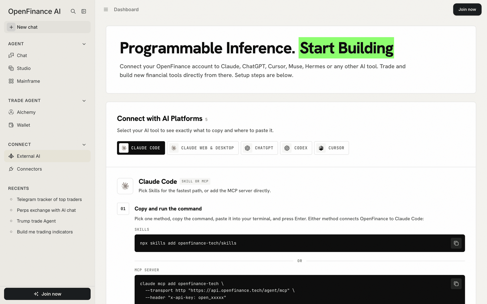

You do it all from one page in the app. It gives you two things to copy, the MCP server URL and your API key, plus step-by-step instructions for each tool.

## How it works

OpenFinance runs an MCP server: a standard way for AI tools to call outside services. Once a tool such as Claude or Cursor is connected to it, that tool can read markets and prepare trades on your OpenFinance account, the same way the in-app chat does.

Every request to the server needs to prove who you are, in one of two ways:

- **OAuth sign-in.** Tools that support it (Claude on web and desktop, ChatGPT) send you to OpenFinance to click **Authorize**. No key to paste.
- **Your API key.** Tools configured by file or command line send your key in an `x-api-key` header.

There is no keyless access. Please make an account at [openfinance.tech](https://openfinance.tech) to get your keys.

<Note>
Every trade needs your confirmation, and nothing here is financial advice. A connected tool acts on your real account, so only connect tools you trust.
</Note>

<Frame caption="The External AI page: pick your tool, follow its steps, copy the URL and key">
  
</Frame>

## What is on the page

The page has two parts: one that walks you through your tool, and one that holds what you copy.

**Connect with AI Platforms.** A row of tools: Claude Code, Claude Web & Desktop, ChatGPT, Codex and Cursor at the time of writing. Click one to see exactly what to copy and where to paste it. Each step has its own copy button, and the last step suggests prompts to try.

**Connect OpenFinance to your AI.** A card with your two credentials:

| Field | What it is |
| --- | --- |
| **MCP server URL** | `https://api.openfinance.tech/agent/mcp`, the address every tool connects to |
| **API key** | Your personal key, starting with `open_`. It is shown masked; the copy button copies the full key |

Your key is created automatically when you first sign in. There is one key per account, and it is the same key the in-app chat uses.

## Connect a tool

<Steps>
  <Step title="Open External AI">
    Click **External AI** in the sidebar under Connect.
  </Step>
  <Step title="Pick your tool">
    Click its chip. The steps below change to match.
  </Step>
  <Step title="Copy and paste">
    Follow the numbered steps. Commands and config snippets already contain your key, so you can paste them as they are.
  </Step>
  <Step title="Test it">
    Ask the tool one of the suggested prompts, for example "Check my OpenFinance Wallet balance".
  </Step>
</Steps>

For the full written guides, including tools not shown on the page, see [API keys](/getting-started/api-keys), [Quick install](/getting-started/quick-install) and the [MCP overview](/mcp/overview).

## The one-time pUSD notice

The first time you open External AI, a notice titled **Send only pUSD to Polymarket** appears. It is there because a connected agent can fund your Polymarket wallet, and anything other than pUSD sent to it can get stuck.

- It tells you to send only **pUSD on Polygon** to your Polymarket deposit address.
- **Open**, next to "Check wallet address here", opens the Deposit sheet on its Polymarket tab so you can confirm the address.
- To close the notice, type `PUSD` in the box and click **I understand**.

You only see it once per account in that browser. If you have not accepted the welcome disclaimer yet, the notice waits until you have.

## Keep your key safe

- Anyone with your key can trade on your behalf. Treat it like a password.
- Do not commit it to a repository or paste it into shared chats. The setup snippets on this page contain your full key, so keep them out of screenshots and screen shares.
- Prefer OAuth sign-in where the tool supports it, so the key never leaves OpenFinance.
- When a tool lets you, store the key in an environment variable instead of a config file.

## Example prompts

Once a tool is connected, try these in that tool:

```text
Check my OpenFinance Wallet balance.
```

```text
Show my Hyperliquid balance and open positions.
```

```text
What are the live prediction markets on the 2028 election?
```

```text
Get the price-implied odds of the Golden State Warriors winning the 2026 NBA playoffs using OpenFinance.
```

```text
What are the highest-volume Polymarket events right now?
```

## FAQ

<AccordionGroup>
  <Accordion title="Where do I create an API key?">
    You do not need to. The key is created for you at first sign-in and shown on this page. If the field is still loading right after sign-up, give it a moment.
  </Accordion>
  <Accordion title="My tool is not in the row. Can I still connect it?">
    Usually yes. Any tool that supports MCP over HTTP can use the server URL with either OAuth or the `x-api-key` header. See the [MCP overview](/mcp/overview).
  </Accordion>
  <Accordion title="Which AI model answers when I use an outside tool?">
    The outside tool's own model, on that tool's own plan. OpenFinance supplies the market data and the trading. AI credits pay for AI work inside OpenFinance; see [Models and AI credits](/product/models-and-credits).
  </Accordion>
  <Accordion title="Is this different from Connectors?">
    Yes. External AI lets outside AI tools use OpenFinance. [Connectors](/product/connectors) bring outside accounts, such as a brokerage, into OpenFinance.
  </Accordion>
</AccordionGroup>

## Next

<CardGroup cols={2}>
  <Card title="API keys" icon="key" href="/getting-started/api-keys">
    How keys and OAuth sign-in work.
  </Card>
  <Card title="Quick install" icon="terminal" href="/getting-started/quick-install">
    Two commands for Claude Code.
  </Card>
  <Card title="MCP overview" icon="plug" href="/mcp/overview">
    The server, its tools and supported clients.
  </Card>
  <Card title="Inference" icon="microchip" href="/inference/overview">
    Call AI models from your own code with the same key.
  </Card>
</CardGroup>
