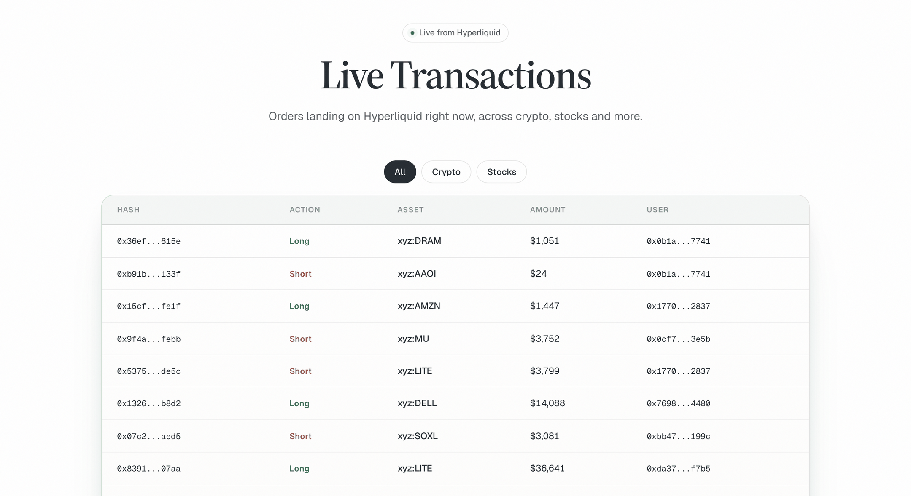

Seeing where large traders put their money is a quick way to get a feel for the market before you form your own view. Live Transactions puts it in one table that fills in by itself as orders land.

## How it works

The page opens a live connection to Hyperliquid and adds each new order to the top of a table. It is a feed of the whole venue, not only of OpenFinance users, and you do not need an account to watch it.

To keep the table readable, it shows large orders: after the first rows have filled in, only orders worth about \$50,000 or more are added. The table keeps the most recent few hundred rows; older ones drop off the end.

You can open it from the **Live Transactions** link at the top of the OpenFinance homepage, or directly at [openfinance.tech/transactions](https://openfinance.tech/transactions).

<Frame caption="Live Transactions: a filter row, then one line per order">
  
</Frame>

## Read the table

Each row is one order.

| Column | What it shows |
| --- | --- |
| **Hash** | The transaction, shortened. Click it to open the transaction in Hyperliquid's explorer |
| **Action** | **Long** or **Short** for perpetuals, **Buy** or **Sell** for spot. Green for buying, red for selling |
| **Asset** | The market the order is for |
| **Amount** | The order's size in dollars |
| **User** | The trader's address, shortened. Click it to open that address in Hyperliquid's explorer |

## Use it

<Steps>
  <Step title="Pick a filter">
    **All** shows everything. **Crypto** shows crypto perps and spot. **Stocks** shows stock markets on Hyperliquid.
  </Step>
  <Step title="Set the page size">
    Use **Rows per page** to show 10, 20, 50 or 100 rows, and the arrows to page back through recent orders.
  </Step>
  <Step title="Dig into an order">
    Click a hash or a user to see the details on Hyperliquid's explorer.
  </Step>
  <Step title="Take it to Chat">
    Copy an asset name or an address and ask the chat about it.
  </Step>
</Steps>

## Example prompts

The table tells you what happened. Chat can tell you more about it:

```text
What is the funding rate and open interest for HYPE perps on Hyperliquid right now?
```

```text
Show the Hyperliquid order book for NVDA and the last hour of price action.
```

```text
Which Hyperliquid stock perps have the highest volume today?
```

```text
Show the open positions for this Hyperliquid address: 0x...
```

## Limits

- **Orders, not fills.** A row means an order was placed. It may fill, partly fill or be cancelled.
- **Large orders only.** Smaller orders are left out once the table has warmed up.
- **Recent only.** The table is a live window, not a history. Reloading the page starts it again.
- **Hyperliquid only.** Other venues are not shown here.

<Note>
A large order is not a signal by itself, and nothing on this page is financial advice. If you act on what you see, every trade you place through OpenFinance still needs your confirmation.
</Note>

## FAQ

<AccordionGroup>
  <Accordion title="The table is empty. Is it broken?">
    Give it a few seconds. Rows appear as new orders arrive, and quiet moments happen. If it stays empty, reload the page.
  </Accordion>
  <Accordion title="Are these OpenFinance users' trades?">
    Not specifically. The feed covers orders across Hyperliquid as a whole.
  </Accordion>
  <Accordion title="Can I see my own orders here?">
    Only if they are large enough to appear. To see your own orders and positions, ask the chat or open [Wallet](/product/wallet).
  </Accordion>
</AccordionGroup>

## Next

<CardGroup cols={2}>
  <Card title="Chat" icon="comments" href="/product/chat">
    Ask about any market or address you spot.
  </Card>
  <Card title="Markets" icon="chart-line" href="/markets/overview">
    What you can trade on Hyperliquid and elsewhere.
  </Card>
  <Card title="Alchemy" icon="flask" href="/alchemy/overview">
    Turn a view on an event into trades.
  </Card>
  <Card title="Safety and custody" icon="shield-halved" href="/reference/safety-and-custody">
    Who holds your funds and who confirms a trade.
  </Card>
</CardGroup>
