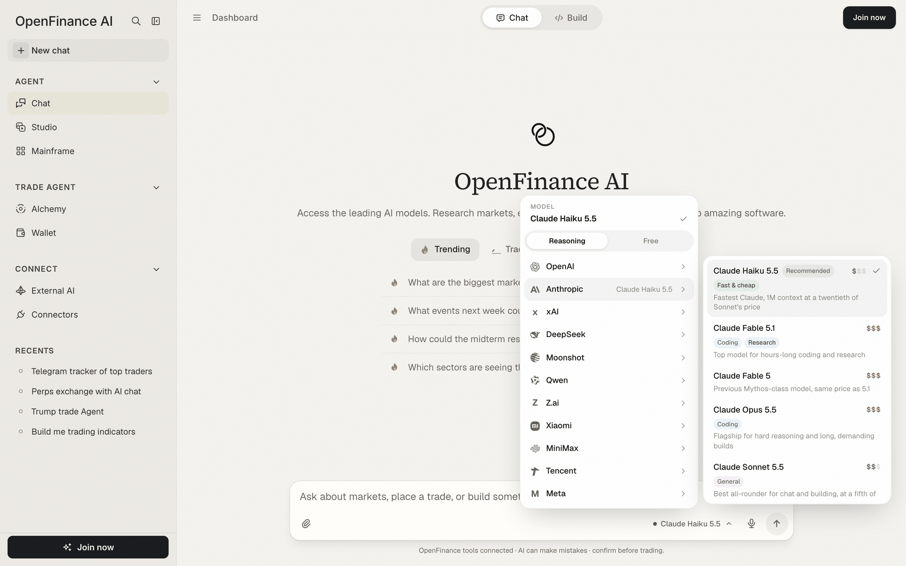
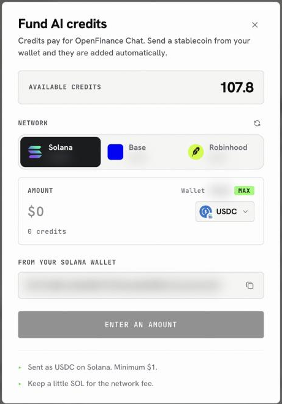

Stronger models cost more per reply and smaller ones cost less, so the right choice depends on the job in front of you, from a quick price lookup to a long piece of research. Whatever you pick, the cost comes out of one place.

## How it works

Every reply in Chat and Build, every Studio image and every Alchemy run uses an AI model, and all of them draw from a single balance of AI credits on your account. The same balance also pays for model calls made with your key from outside the app (see [Inference](/inference/overview)).

## The model picker

The picker sits in the chat message box and shows the model in use. Click it to change model.

<Frame caption="The model picker: category tabs on top, companies on the left, that company's models on the right">
  
</Frame>

What you see inside:

- **Category tabs.** In Chat mode the picker lists **Reasoning** models; in Build mode it lists **Coding** models. Both modes also have a **Free** tab.
- **Companies.** Models are grouped by the company that makes them, for example Anthropic, OpenAI, xAI, DeepSeek and Moonshot. Hover or click a company to see its models.
- **Price tier.** Each model shows one to three dollar signs: low, mid or premium. Hover the tier to see its price per million output tokens. Free models show **Free**.
- **Strength tags.** Short labels such as Coding, Research, General, Fast & cheap or Reads images tell you what a model is good at.
- **A one-line description** of when to use it.

The default in both modes is Claude Haiku 5.5, marked **Recommended**. The list changes as new models come out, so treat any names here as examples and check the picker for what is available today.

### "Latest" entries

Some families have an entry tagged **Latest**, for example the newest Claude Opus or the newest Grok. A Latest entry always points at the newest model of that family and switches by itself when a new one is released. Pick it when you want to stay current without checking back; pick a fixed version when you want the same model every time.

### How model choice behaves

- A model you pick stays for that chat. A new chat starts on the default again.
- When you switch between Chat and Build, your model comes along if the other list has it.
- If a model is retired, older chats that used it move to its replacement.
- [Alchemy](/alchemy/overview) and [Studio](/product/studio) have their own shorter pickers, with models suited to those jobs.

## Free models

The **Free** tab lists OpenFinance's free models, such as OpenFi Advanced (which can read charts and screenshots), OpenFi Alpha and OpenFi Sense. They do not spend your AI credits.

Two things to know:

- **They need a funded account.** If your account has no credits, the app shows "Deposit to start chatting" and asks for a minimum deposit of \$10 before free models can be used.
- **They share capacity.** At busy times a free model can stall or skip a reply. When that happens the app offers to retry on a paid model or to try the free one again.

## AI credits

### Where to see your balance

- Next to your name at the bottom of the sidebar.
- In the panel behind the **Deposit** button in the top bar, with credits available and used.
- On the **Wallet** page, in the **AI Credits** card.
- In Build mode's side panel, on the **Credits** row.

### What spends credits

| Activity | How the cost is shown |
| --- | --- |
| Chat and Build replies | Depends on the model's price tier and how long the reply is |
| Studio images | The cost in credits is shown before you generate |
| Alchemy runs | Charged for live runs; sample runs marked **Try me** are free |

### Top up

The short version is below; [Buy with crypto](/funding/buy-credits-with-crypto) walks through every screen and every message the Fund button can show.

<Steps>
  <Step title="Open Fund AI credits">
    Click **Buy credits** in the top bar panel, **Buy more** on the Wallet page, or **Fund it** next to Stablecoin under **Settings > Billing**.
  </Step>
  <Step title="Pick a network and token">
    Choose Solana, Base or Robinhood Chain, then a stablecoin your OpenFinance wallet holds on that network. A network that cannot take deposits yet is marked **Soon**.
  </Step>
  <Step title="Enter an amount">
    The box shows roughly how many credits you get; \$1 comes to about 10 credits. The button tells you if the amount is under the minimum, more than you hold, or if you need a little of the network's coin for gas.
  </Step>
  <Step title="Fund">
    Click **Fund**. The transfer is sent from your OpenFinance wallet and your new balance appears once it is confirmed.
  </Step>
</Steps>

<Frame caption="Fund AI credits: network, token, amount and the estimated credits">
  
</Frame>

<Tip>
Credits are bought with stablecoins that are already in your OpenFinance wallet. If the wallet is empty, [deposit](/product/wallet) first. Paying by card is marked **Coming soon** in Settings.
</Tip>

### Free Compute

**Settings > Free Subscription** shows a **Free Compute** card: a monthly reward that unlocks when your perpetuals trading volume for the calendar month reaches the threshold on the card. Volume updates every 24 hours. Once unlocked, click **Claim reward** to receive a redeem code with instructions.

## Tips

- Use a low-tier model for quick lookups and a higher tier for long research or large builds.
- If a reply fails on a free model, retry on the paid default instead of resending the same message.

## FAQ

<AccordionGroup>
  <Accordion title="The chat says I am out of credits. What now?">
    Click **Buy AI credits** on the message and fund from your wallet. Your chat stays as it is, and you can retry the message afterward.
  </Accordion>
  <Accordion title="My transfer went out but credits did not appear">
    Solana deposits are picked up automatically within a few minutes. For other networks, keep the transaction hash the app shows and send it to support at dev@openfinance.tech so the credits can be applied.
  </Accordion>
  <Accordion title="Do credits pay for trades?">
    No. Credits pay for AI work only. Your trades use the funds in your wallet and on each venue; see [Deposit funds](/funding/deposit-funds).
  </Accordion>
</AccordionGroup>

## Next

<CardGroup cols={2}>
  <Card title="Chat" icon="comments" href="/product/chat">
    Where you use the model picker day to day.
  </Card>
  <Card title="Inference" icon="microchip" href="/inference/overview">
    Call models from your own code with the same key and credits.
  </Card>
  <Card title="Wallet" icon="wallet" href="/product/wallet">
    Deposit the stablecoins you buy credits with.
  </Card>
  <Card title="Buy with crypto" icon="coins" href="/funding/buy-credits-with-crypto">
    Top up your credits step by step.
  </Card>
</CardGroup>
