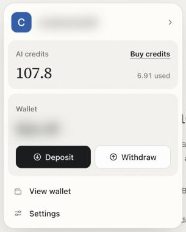
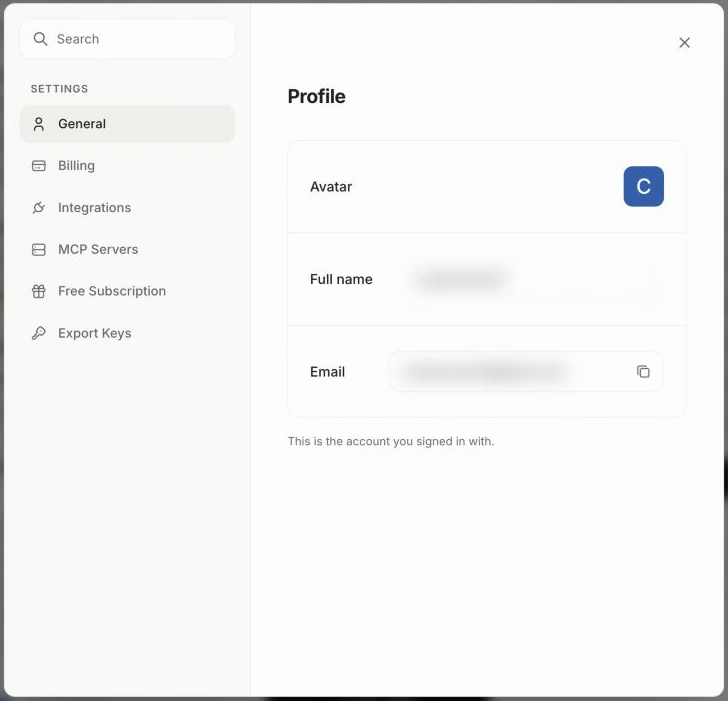

There are three ways in: the **Deposit** panel in the top bar, the account row at the bottom of the sidebar, and the **Settings** window. Before the tour, it helps to know what one account covers.

## How it works

You sign in to OpenFinance with your email address. That one account owns your wallet, your API key, your AI credits and your saved sessions. Settings does not change how trading works; it is where you manage the account around it.

## The account panel

Click **Deposit** in the top bar, or your name at the bottom of the sidebar. Both open the same panel.

<Frame caption="The account panel: credits, wallet balance and shortcuts">
  
</Frame>

| Part | What it does |
| --- | --- |
| **Your name** | Opens Settings |
| **AI credits** | Credits available and used, with **Buy credits** |
| **Wallet** | Your total balance, with **Deposit** and **Withdraw** |
| **View wallet** | Opens the [Wallet](/product/wallet) page |
| **Settings** | Opens the Settings window |

From the sidebar, the panel also has:

- **Help & feedback**: **Contact support** (email to dev@openfinance.tech) and **Docs**.
- **Learn more**: Terms of Service, Privacy Policy and Tutorials.
- **Sign out**.

The avatar at the far right of the top bar has a shorter menu: **Purchase OpenFinance credits**, **Settings** and **Sign out**.

## The Settings window

Settings opens as a window over the page you are on, with a search box and six sections.

<Frame caption="Settings, with its six sections on the left">
  
</Frame>

| Section | What is there |
| --- | --- |
| **General** | Your profile: avatar, name and the email you signed in with, with a copy button |
| **Billing** | Your plan and the ways to pay. **Stablecoin** has a **Fund it** button that opens Fund AI credits; **Credit / Debit card** is marked Coming soon |
| **Integrations** | GitHub and Vercel, with **Connect**, **Reconnect** and **Disconnect** |
| **MCP Servers** | Brokerage and data connectors, with a search box and Connect and Disconnect per server |
| **Free Subscription** | The **Free Compute** reward card |
| **Export Keys** | **Export EVM Key** and **Export Solana Key** for your embedded wallet |

Integrations and MCP Servers show the same connections as the [Connectors](/product/connectors) page, so use whichever is closer to hand.

## Common tasks

If you came here to do one thing, it is probably one of these.

<AccordionGroup>
  <Accordion title="Top up AI credits">
    Open the account panel and click **Buy credits**, or go to **Settings > Billing** and click **Fund it**. See [Models and AI credits](/product/models-and-credits).
  </Accordion>
  <Accordion title="Connect or disconnect GitHub and Vercel">
    Go to **Settings > Integrations**. Disconnecting here forgets the connection on the OpenFinance side; to fully revoke access, also remove it in GitHub or Vercel.
  </Accordion>
  <Accordion title="Export my wallet keys">
    Go to **Settings > Export Keys**. All EVM chains share one key and Solana has its own. Anyone with these keys can move everything in the wallet, so never paste them into a chat, an email or a site you do not fully trust.
  </Accordion>
  <Accordion title="Check my Free Compute progress">
    Go to **Settings > Free Subscription**. The card shows this month's perpetuals volume against the threshold, the reward, and the date it resets.
  </Accordion>
  <Accordion title="Find my API key">
    It is not in Settings. Open [External AI](/product/external-ai) in the sidebar.
  </Accordion>
  <Accordion title="Get help">
    Click your name at the bottom of the sidebar, then **Help & feedback > Contact support**. You can also reach OpenFinance on X at [@openfinancelabs](https://x.com/openfinancelabs).
  </Accordion>
</AccordionGroup>

## The sidebar

The sidebar is the app's main navigation.

- **New chat** starts a fresh chat.
- Three sections, **Agent**, **Trade Agent** and **Connect**, hold the pages. Click a section's name to fold it.
- **Recents** lists your chats, Studio sessions and Alchemy runs. Search them, filter by type, and delete a session from its options menu. A session that is still working shows a moving marker.
- The collapse button at the top shrinks the sidebar to icons. Your choice is kept as you move between pages.

## The welcome disclaimer

The first time you sign in, a disclaimer appears before anything else. It explains that OpenFinance is experimental, that it does not give financial advice, that AI can be wrong, and that your API key gives full access to your wallet. You must tick four boxes and click **I understand & agree** to continue. It is shown once per account.

<Note>
Every trade needs your confirmation, and nothing in OpenFinance is financial advice. Never trade more than you can afford to lose.
</Note>

## FAQ

<AccordionGroup>
  <Accordion title="Can I change my email or name?">
    The profile shows the email you signed in with and a name taken from it. There is no edit control in Settings today.
  </Accordion>
  <Accordion title="Can I pay by card?">
    Not yet. Card payment is marked Coming soon. Credits are bought with stablecoins from your OpenFinance wallet.
  </Accordion>
  <Accordion title="How do I sign out?">
    Use **Sign out** in the sidebar account panel or in the avatar menu in the top bar.
  </Accordion>
</AccordionGroup>

## Next

<CardGroup cols={2}>
  <Card title="Wallet" icon="wallet" href="/product/wallet">
    Balances, deposits, sending and key export.
  </Card>
  <Card title="Models and AI credits" icon="coins" href="/product/models-and-credits">
    How credits work and how to top up.
  </Card>
  <Card title="Connectors" icon="plug" href="/product/connectors">
    Manage every connected account in one place.
  </Card>
  <Card title="External AI" icon="robot" href="/product/external-ai">
    Your MCP server URL and API key.
  </Card>
</CardGroup>
