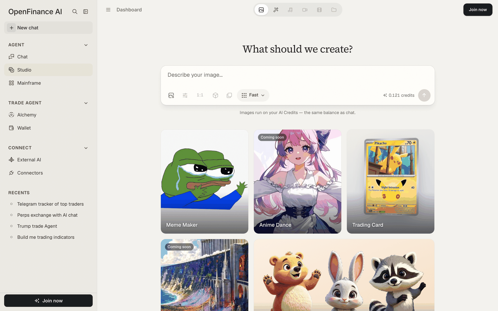

Studio makes images with AI. Describe what you want, or upload a picture and describe the change, and Studio generates it, paid for from the same AI credits as Chat.

## How it works

Studio is a feed of prompts and results, like a chat that answers in pictures. Each prompt runs on an image model you choose. The cost in credits is shown before you generate, so there is no surprise afterward. A follow-up such as "make it bluer" works because Studio sends the newest image along as context.

Two modes are live today:

| Mode | What it does |
| --- | --- |
| **Image** | Creates a new image from a text description |
| **Edit** | Changes a reference image you upload, following your description |

The mode switcher in the top bar also lists Music, Video, Story Editor and Folders. Those are marked **Coming soon** and cannot be used yet.

<Frame caption="Studio's empty page: the prompt box with example cards underneath">
  
</Frame>

## Generate an image

<Steps>
  <Step title="Open Studio">
    Click **Studio** in the sidebar under Agent. The page asks "What should we create?".
  </Step>
  <Step title="Describe the image">
    Type a description in the box, or click one of the example cards (Meme Maker, Trading Card, Plush Mascot and others) to load its prompt and adjust it.
  </Step>
  <Step title="Check the model and cost">
    The model picker in the box lists the image models and what one image costs in credits. Your choice is remembered. The cost of the next image shows beside the send button.
  </Step>
  <Step title="Generate">
    Click the send button. The result appears in the feed. Click it to view full size.
  </Step>
</Steps>

## Edit an image

<Steps>
  <Step title="Switch to Edit">
    Pick **Edit** in the mode switcher at the top.
  </Step>
  <Step title="Add a reference image">
    Click the reference image button in the box and choose a PNG, JPEG or WebP file. Keep it under about 6 MB.
  </Step>
  <Step title="Describe the edit">
    Say what should change and what should stay, then send.
  </Step>
</Steps>

## After it generates

Under each result you get:

- **Download**, to save the image as a PNG.
- **Edit prompt**, to load that prompt back into the box so you can change it and run it again.
- The number of credits the image cost.

## Example prompts

```text
A plush knitted mascot for a finance app, sky blue, round and friendly, holding a pink phone, white background, product photo.
```

```text
A holographic trading card of an electric yellow mouse creature: foil frame, energy symbol, attack text and stats, collectible card art.
```

```text
Three 3D cartoon animal mascots in one style: a waving bear, a sitting bunny and a cheerful raccoon. Soft fur, big eyes, plain white background.
```

```text
A round token logo of a green frog wearing a gold crown, flat vector style, thick outline, solid dark background.
```

```text
Make the background a night sky and keep the character exactly as it is.
```

The last one is an Edit prompt: use it with a reference image, or as a follow-up to an image you just made.

## Tips

- Describe subject, style, background and lighting. "Product photo, white background" or "flat vector, thick outline" steers the result more than adjectives do.
- Iterate in the same session. Short follow-ups build on the newest image.
- Download anything you want to keep. See the limit below.

## Limits

- **Images live in your browser.** A generated image is kept only in the browser that made it. If you open the session elsewhere, or clear your browser data, Studio shows that the image is no longer there and offers **Generate it again**.
- **Prompt length.** A prompt can be up to 2,000 characters.
- **Not yet available.** Aspect ratio, style, variations and settings controls are visible but marked Coming soon.
- **Credits.** If you run out, the feed shows **Add credits**. See [Models and AI credits](/product/models-and-credits).

## FAQ

<AccordionGroup>
  <Accordion title="Where do my Studio sessions go?">
    They appear in **Recents** in the sidebar, next to your chats. Use the filter to show Studio only.
  </Accordion>
  <Accordion title="What happens if I close the tab while an image is generating?">
    The run still finishes and the session stays in Recents. Images are stored in your browser though, so one that did not reach it shows as missing, with a **Generate it again** button. Keep the tab open until the image appears.
  </Accordion>
  <Accordion title="Can Studio make video or music?">
    Not yet. Those modes are listed as Coming soon. Image and Edit are live today.
  </Accordion>
</AccordionGroup>

## Next

<CardGroup cols={2}>
  <Card title="Models and AI credits" icon="coins" href="/product/models-and-credits">
    How image costs come out of your credit balance.
  </Card>
  <Card title="Build mode" icon="hammer" href="/product/build-mode">
    Build the site your new artwork belongs on.
  </Card>
  <Card title="Mainframe" icon="layer-group" href="/mainframe/overview">
    Website and app templates you can launch as they are.
  </Card>
  <Card title="Chat" icon="comments" href="/product/chat">
    Research and trade in plain language.
  </Card>
</CardGroup>
