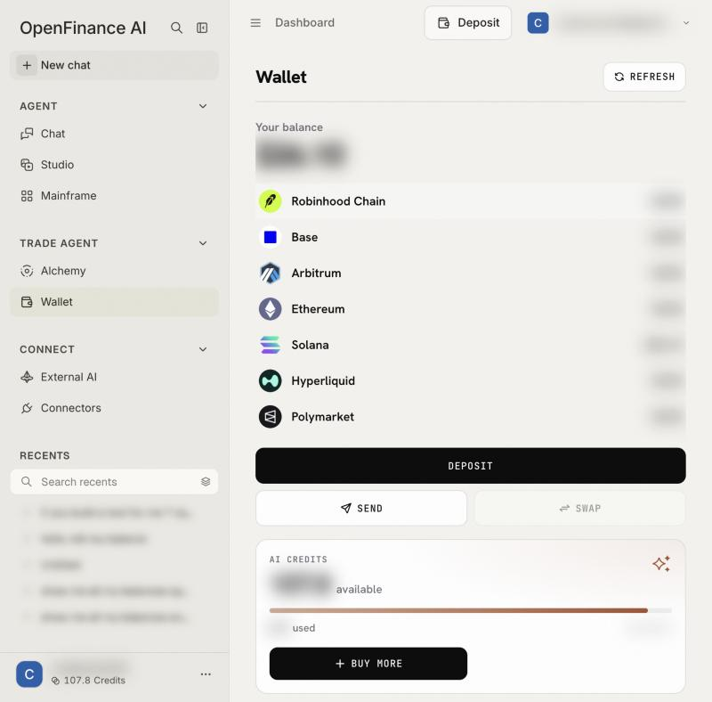
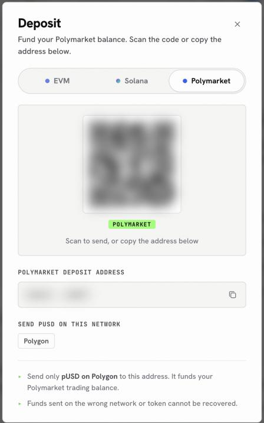

Every OpenFinance account comes with its own wallet. It holds the funds your trades use, and the Wallet page shows everything in one place: each chain, your Hyperliquid account and your Polymarket balance.

## How it works

The wallet is embedded and self-custodial, powered by Privy. It is created when you sign up, so there is nothing to install. You get:

- **One EVM address** that is the same on every EVM chain (Ethereum, Base, Arbitrum, Polygon, Robinhood Chain and others).
- **One Solana address.**
- **A Polymarket deposit address**, a separate address on Polygon that holds the balance Polymarket trades from.

The agent can prepare transactions from this wallet, but you confirm each one. You can export the private keys whenever you like.

<Note>
Every trade and transfer needs your confirmation, and nothing here is financial advice. Transfers on a blockchain cannot be reversed.
</Note>

<Frame caption="The Wallet page: total balance and venues on the left, tokens for the selected venue on the right">
  
</Frame>

## Read your balances

Open **Wallet** in the sidebar under Trade Agent.

- **Your balance** is the total across every venue that has loaded.
- The **venue list** shows a value per venue: Robinhood Chain, Base, Arbitrum, Ethereum, Solana, Hyperliquid and Polymarket. Click one to see its tokens.
- For the selected venue you see its balance, its address (with a copy button and a link to the block explorer), and a table with **Token**, **Balance**, **Value**, **PnL** and **Actions**.
- **Search tokens** filters the table. **Hide tokens without a price** is on by default, which keeps airdropped spam out of view; turn it off to see everything.

Balances are read when you open a wallet screen and reused for a short while. Click **Refresh** to read them again; the button pauses for a few seconds between presses.

The **AI Credits** card on the same page shows credits available and used, with **Buy more**. See [Models and AI credits](/product/models-and-credits).

## Deposit

Every venue takes one token on one network, so the tab you pick matters. [Deposit funds](/funding/deposit-funds) has the full guide, with a page each for Polymarket, Hyperliquid and onchain tokens.

<Steps>
  <Step title="Open the Deposit sheet">
    Click **Deposit** on the Wallet page, or **Deposit** in the top bar and then **Deposit** in the panel.
  </Step>
  <Step title="Pick the tab">
    **EVM** for any EVM network, **Solana** for Solana, **Polymarket** for your Polymarket balance.
  </Step>
  <Step title="Send funds to the address">
    Scan the QR code or copy the address, then send from your other wallet or exchange. The sheet lists the networks that address accepts.
  </Step>
</Steps>

Each tab takes different funds, so check you are on the right one before you send.

| Tab | Send | Networks listed |
| --- | --- | --- |
| **EVM** | EVM assets only | Ethereum, Polygon, Base, Arbitrum, Optimism, Hyperliquid, Robinhood |
| **Solana** | Solana assets only | Solana |
| **Polymarket** | pUSD only | Polygon |

<Warning>
Funds sent on the wrong network or as the wrong token cannot be recovered. For Polymarket, send only pUSD on Polygon, and only to the address shown on the Polymarket tab.
</Warning>

Hyperliquid works differently. To fund it, hold USDC on Arbitrum and ask the chat to deposit it. Hyperliquid accepts USDC only, and its deposits come from Arbitrum.

<Frame caption="The Deposit sheet on its Polymarket tab">
  
</Frame>

## Send and withdraw

**Send** moves a token from your wallet to another address on the same chain.

<Steps>
  <Step title="Open Send">
    Click **Send** on the Wallet page, **Send** on a token's row, or **Withdraw** in the top bar panel.
  </Step>
  <Step title="Fill in the transfer">
    Choose the venue and token, paste the recipient address and enter an amount. Leave a little of the chain's own coin for gas.
  </Step>
  <Step title="Review">
    The **Review transfer** step shows the details. If the address is not one of your own wallets, you must tick a box confirming that you checked the full address.
  </Step>
  <Step title="Confirm">
    A final check asks you to read the address end to end. Click **Yes, send it**.
  </Step>
</Steps>

What Send does not do:

- **Bridging and swaps run through chat.** The **Swap** button on the Wallet page is disabled for now; ask the chat to swap or bridge instead.
- **Hyperliquid and Polymarket balances** have no plain Send. Their rows say **via chat**. Ask the chat to withdraw; Hyperliquid withdrawals go to your address on Arbitrum for a flat \$1 and take about 5 minutes.

## Export your keys

<Steps>
  <Step title="Open Settings">
    Open the account menu and click **Settings**, then **Export Keys**.
  </Step>
  <Step title="Choose a key">
    Click **Export EVM Key** or **Export Solana Key**. All EVM chains share one key; Solana has its own.
  </Step>
  <Step title="Store it safely">
    The key is shown in a secure Privy window. Keep it offline.
  </Step>
</Steps>

<Warning>
Anyone with these keys can move every dollar in the wallet. Never paste them into a chat, an email or a site you do not fully trust.
</Warning>

## Launches tab

Next to **Tokens**, the **Launches** tab lists tokens your wallet has created, with any creator earnings you can claim.

## Example prompts

Wallet actions that the page does not do itself go through [Chat](/product/chat):

```text
Show my wallet addresses and balances on every chain.
```

```text
Deposit 50 USDC from Arbitrum to my Hyperliquid account.
```

```text
Swap 20 USDC to SOL on Solana. Show me the quote first.
```

```text
Bridge 100 USDC from Base to Arbitrum.
```

```text
Withdraw 40 USDC from Hyperliquid to my Arbitrum address.
```

## FAQ

<AccordionGroup>
  <Accordion title="Who holds my funds?">
    You do. The wallet is self-custodial: trades and transfers are signed by your own wallet, and you can export the keys.
  </Accordion>
  <Accordion title="A venue shows 'failed' or the total looks low">
    One of the balance reads did not come back. The total only counts venues that loaded. Click **Refresh** in a moment.
  </Accordion>
  <Accordion title="Why does the page say my agent key is still being set up?">
    Right after sign-up, your key is still being created. Balances load as soon as it is ready.
  </Accordion>
  <Accordion title="I see tokens I never bought">
    Anyone can send tokens to a public address. Leave unknown tokens alone, and keep **Hide tokens without a price** on.
  </Accordion>
</AccordionGroup>

## Next

<CardGroup cols={2}>
  <Card title="Quickstart" icon="rocket" href="/welcome/quickstart">
    Fund the wallet and place a first trade.
  </Card>
  <Card title="Markets" icon="chart-line" href="/markets/overview">
    Where each balance can be used.
  </Card>
  <Card title="Settings and account" icon="gear" href="/product/settings">
    The account menu, Settings and key export.
  </Card>
  <Card title="Deposit funds" icon="arrow-down-to-bracket" href="/funding/deposit-funds">
    Which tab to use for each venue.
  </Card>
</CardGroup>
