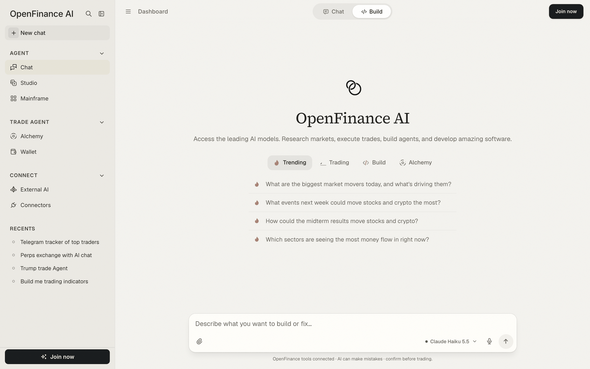

OpenFinance can build apps as well as trade. Describe what you want in the chat, and Build mode writes the code, runs it and shows you a live preview. When you like it, ship it to your own GitHub and Vercel.

You can start in one of two ways.

<CardGroup cols={2}>
  <Card title="From a template" icon="table-cells-large" href="/mainframe/overview">
    Pick a ready-made tool or site in Mainframe and deploy it. Fastest way to something that works.
  </Card>
  <Card title="From a prompt" icon="hammer" href="/product/build-mode">
    Describe exactly what you want in Build mode and shape it by chatting.
  </Card>
</CardGroup>

## Build from a prompt

Templates have their own guide in Mainframe. Starting from a prompt works like this:

<Steps>
  <Step title="Switch to Build">
    Open [openfinance.tech/chat](https://openfinance.tech/chat) and choose **Build** in the toggle at the top.
  </Step>
  <Step title="Describe the app">
    Be specific about what it shows and what it does. For example:

    ```text
    Build a one-page dashboard that shows live BTC, ETH and SOL prices and funding rates from Hyperliquid, refreshing every 10 seconds, with a dark theme.
    ```
  </Step>
  <Step title="Watch it build">
    A checklist shows each stage. When the build is done, the preview opens next to the chat.
  </Step>
  <Step title="Ask for changes">
    Keep chatting: "add a chart under each price", "make the table sortable". Each change updates the preview.
  </Step>
  <Step title="Ship it">
    Connect GitHub and Vercel once, then click **Push** or **Deploy**, or simply ask "Deploy this app to Vercel." A deploy gives the app a permanent address on your own Vercel account.
  </Step>
</Steps>

<Frame caption="Build selected in the top bar of the chat">
  
</Frame>

## Next

<CardGroup cols={3}>
  <Card title="Build mode" icon="hammer" href="/product/build-mode">
    The preview, the Build panel and shipping in detail.
  </Card>
  <Card title="Mainframe" icon="table-cells-large" href="/mainframe/overview">
    Templates you can deploy and change.
  </Card>
  <Card title="Connectors" icon="plug" href="/product/connectors">
    Connect GitHub and Vercel before you ship.
  </Card>
</CardGroup>
