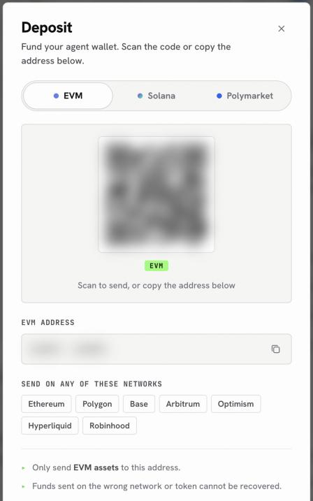
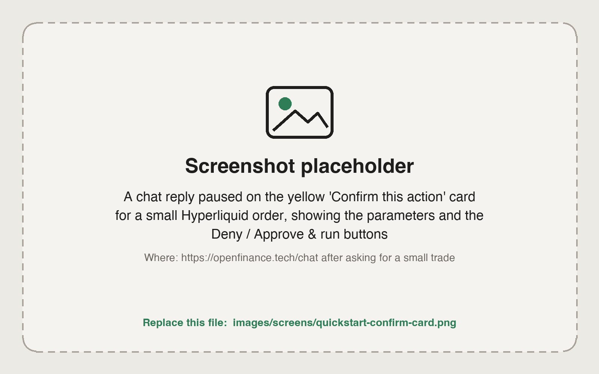

Plan for about ten minutes, plus the time your deposit takes to arrive. You will sign up, fund your wallet, add AI credits, and then ask the chat for a small trade that you approve yourself.

<Note>
Every trade needs your confirmation, and nothing here is financial advice. Start with a small amount while you learn how the app behaves.
</Note>

## Before you start

You need an email address and some crypto you can send from another wallet or exchange: a stablecoin such as USDC, and a little of the network's own coin for gas.

## Steps

<Steps>
  <Step title="Sign up with your email">
    Go to [openfinance.tech](https://openfinance.tech) and click **Sign In** (inside the app the button reads **Join now**). Enter your email and the code you receive. You land in **Chat**.
  </Step>
  <Step title="Read and accept the welcome disclaimer">
    The first time you sign in, a disclaimer explains that the product is experimental, that AI can be wrong, and that your API key gives full access to your wallet. Tick all four boxes, then click **I understand & agree**.
  </Step>
  <Step title="Find your wallet">
    Your embedded wallet and your API key are created automatically. Open **Wallet** in the sidebar to see it. If you see "Your agent key is still being set up", wait a moment; balances load as soon as it is ready.
  </Step>
  <Step title="Deposit funds">
    Click **Deposit** in the top bar, then **Deposit** again in the panel. Pick the **EVM**, **Solana** or **Polymarket** tab, then scan the QR code or copy the address and send funds to it from your other wallet or exchange. [Deposit funds](/funding/deposit-funds) explains which tab to use for each venue.
  </Step>
  <Step title="Add AI credits">
    AI replies are paid for with AI credits. Open the same top bar panel and click **Buy credits**. Choose a network, enter an amount and confirm. The stablecoin is sent from your OpenFinance wallet and the credits are added automatically. See [Buy with crypto](/funding/buy-credits-with-crypto) for each screen.
  </Step>
  <Step title="Ask the chat">
    Open **Chat** and start with a read-only question to check everything works, then ask for the trade you want. Be specific about the market, the side and the size.
  </Step>
  <Step title="Confirm the trade">
    Before anything that can move funds or place an order, the chat shows a **Confirm this action** card with the details. Check them, then click **Approve & run**, or **Deny** to cancel. The result appears in the chat.
  </Step>
</Steps>

<Frame caption="The Deposit sheet: pick a tab, then scan the code or copy the address">
  
</Frame>

## Which funds go where

Send the right asset on the right network. Funds sent on the wrong network or token cannot be recovered.

| You want to | Send this | To this tab in Deposit |
| --- | --- | --- |
| Trade perps or spot on Hyperliquid | USDC on Arbitrum, then ask the chat to move it to Hyperliquid | EVM |
| Trade on Polymarket | pUSD on Polygon only | Polymarket |
| Swap tokens on Solana | SOL for gas plus the token you want to spend | Solana |
| Buy AI credits | A stablecoin on Solana, Base or Robinhood Chain, plus a little of that network's coin for gas | EVM or Solana |

Hyperliquid accepts USDC only, and its deposits come from Arbitrum. The Polymarket address is a separate deposit address, not your EVM address, so always copy it from the **Polymarket** tab.

## First prompts to try

Once your deposit has arrived, these prompts take you from checking your setup to a small first trade. Start by checking your setup:

```text
Show my wallet addresses and balances on every chain.
```

```text
Show my Hyperliquid balance and open positions.
```

Then look before you trade:

```text
What is the BTC perp price and funding rate on Hyperliquid right now?
```

```text
What are the highest-volume Polymarket events right now?
```

When you are ready, place a small first trade:

```text
Open a $20 long on BTC perps on Hyperliquid with 2x leverage. Show me the order details before you place it.
```

<Frame caption="The confirmation card the chat shows before a trade is sent">
  
</Frame>

## If something does not work

<AccordionGroup>
  <Accordion title="The chat says I have no AI credits">
    New accounts start with no credits. Click **Buy AI credits** on the message, or **Buy credits** in the top bar panel. The free models also need a funded account: the app asks for a minimum deposit of \$10 before you can use them, and they do not spend your credits afterward.
  </Accordion>
  <Accordion title="My deposit has not shown up">
    Open **Wallet** and click **Refresh**. Check that you sent the asset on a network listed in the Deposit sheet. Balances are read from the chain, so a transfer that is still confirming will not appear yet.
  </Accordion>
  <Accordion title="The reply stopped halfway">
    A paused run shows a **Continue run** card. Click it to pick up from the last step. The agent is told not to repeat any trade that already went through.
  </Accordion>
</AccordionGroup>

## Next

<CardGroup cols={2}>
  <Card title="Chat" icon="comments" href="/product/chat">
    Modes, starter prompts, attachments and confirmation cards.
  </Card>
  <Card title="Wallet" icon="wallet" href="/product/wallet">
    Balances, deposits, sending and key export.
  </Card>
  <Card title="Models and AI credits" icon="coins" href="/product/models-and-credits">
    Pick a model and understand how credits are spent.
  </Card>
  <Card title="Deposit and buy credits" icon="wallet" href="/funding/overview">
    Funding each venue and topping up credits.
  </Card>
</CardGroup>
