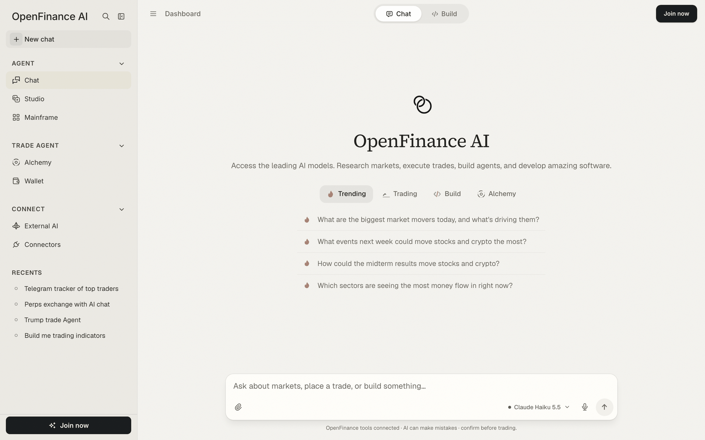
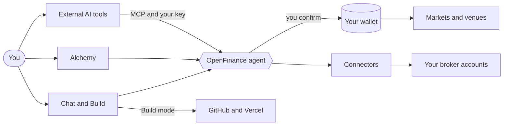

OpenFinance is an AI trading workspace at [openfinance.tech](https://openfinance.tech). You talk to AI models in plain language, and those models can look up markets, prepare trades from your own wallet, and build working apps for you.

## What it is

Every account brings three things together:

- **An AI chat with market tools.** Ask about prices, funding rates, prediction market odds or your own balances. When you ask for a trade, the agent prepares it and waits for you to confirm.
- **A self-custodial wallet.** An embedded wallet, powered by Privy, is created when you sign up. It has one EVM address that works on every EVM chain, plus one Solana address. You can export the keys at any time.
- **A builder.** Build mode turns a prompt into a running app with a live preview, and ships it to your own GitHub and Vercel accounts.

<Note>
Every trade needs your confirmation, and nothing in OpenFinance or in these docs is financial advice. AI models can be wrong, so check what they tell you before you act on it.
</Note>

## Who it is for

- **Traders** who want to research and place trades across venues from one chat, instead of one dashboard per venue.
- **Builders** who want a trading bot, dashboard or token site without setting up a project by hand.
- **People who already use Claude, ChatGPT or Cursor** and want those tools to reach markets through their OpenFinance account.

## The surfaces

After you sign in, the left sidebar groups everything into three sections, with your recent sessions underneath.

| Sidebar section | Page | What you do there |
| --- | --- | --- |
| Agent | [Chat](/product/chat) | Ask questions, research markets and place trades. Switch to [Build mode](/product/build-mode) to make apps. |
| Agent | [Studio](/product/studio) | Generate and edit images with AI. |
| Agent | [Mainframe](/mainframe/overview) | Pick a ready-made template and have it built for you. |
| Trade Agent | [Alchemy](/alchemy/overview) | Type an event or thesis and get the trades it implies. |
| Trade Agent | [Wallet](/product/wallet) | See balances on every chain and venue, deposit and send. |
| Connect | [External AI](/product/external-ai) | Connect Claude, ChatGPT, Cursor and other AI tools to your account. |
| Connect | [Connectors](/product/connectors) | Link brokerages, data sources, GitHub and Vercel. |

Two more places are worth knowing: the **Deposit** button and account menu in the top bar (see [Settings and account](/product/settings)), and the public [Live Transactions](/product/live-transactions) page.

<Frame caption="The OpenFinance app after sign-in: sidebar on the left, Chat in the middle">
  
</Frame>

## How the pieces fit

Every request follows the same path, whether it starts in the app or in an outside AI tool.

1. **You ask.** In Chat, in Alchemy, or from an outside AI tool connected through External AI.
2. **The agent works.** It reads market data and prepares the action. AI replies are paid for with [AI credits](/product/models-and-credits).
3. **You confirm.** Anything that moves funds or places an order shows a confirmation step first.
4. **Your wallet signs.** Trades settle on the venue itself, from the wallet or broker account that belongs to you.

## What you get when you sign up

Signing up takes a minute and gives you three things straight away:

- An account tied to your email address.
- An embedded wallet with an EVM address and a Solana address.
- One API key that starts with `open_`, created for you automatically. It powers the in-app chat tools and outside AI tools alike.

Creating an account is free. AI replies are paid for with AI credits; see [Models and AI credits](/product/models-and-credits).

## Good to know

- OpenFinance is new, experimental software. On first sign-in you read and accept a disclaimer before you can continue.
- Your trades run directly on outside venues and protocols. OpenFinance does not control them.
- Treat your API key and wallet keys like passwords. Anyone who has them can act on your account.

## Next

<CardGroup cols={2}>
  <Card title="Quickstart" icon="rocket" href="/welcome/quickstart">
    Go from zero to a first confirmed trade in the app.
  </Card>
  <Card title="Chat" icon="comments" href="/product/chat">
    Learn the two modes, starter prompts and confirmation cards.
  </Card>
  <Card title="Markets" icon="chart-line" href="/markets/overview">
    See which markets and venues you can reach.
  </Card>
  <Card title="MCP server" icon="plug" href="/mcp/overview">
    Use OpenFinance from Claude, ChatGPT, Cursor and other tools.
  </Card>
</CardGroup>
